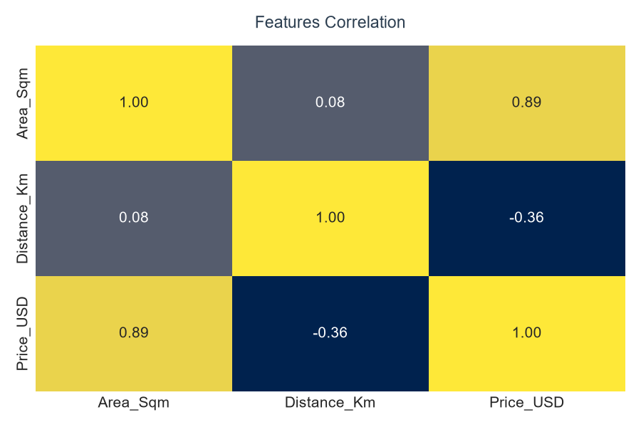
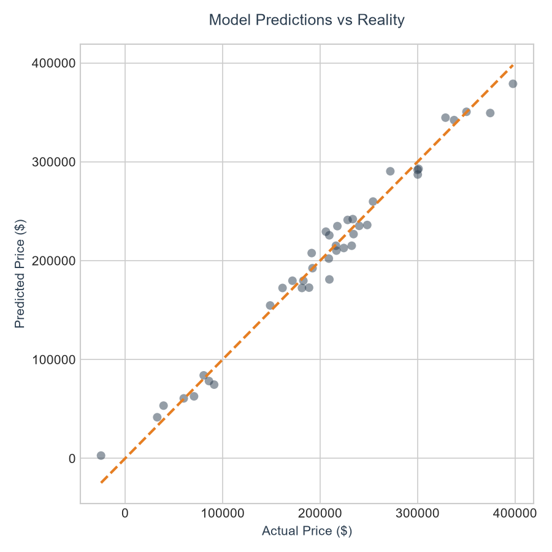

## Performance Metrics
* **R² Score:** 0.9377 (The model explains ~93.8% of the price variance)
* **MAE (Mean Absolute Error):** $4,680.49

## How to Run
1. Install dependencies using `uv` or `pip`:
   ```bash
   pip install numpy pandas matplotlib seaborn scikit-learn
   ```
2. Run the script:
   ```bash
   python linear_regression.py
   ```
## Visualizations


